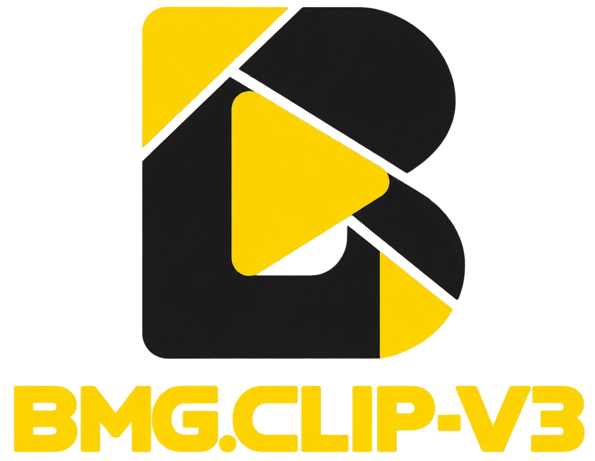
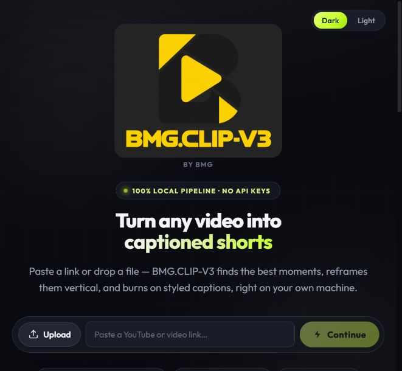

# BMG.CLIP-V3

<p align="center"></p>

A local AI video clipping app with a React dashboard, Whisper transcription, styled captions, manual reframing, and FFmpeg rendering.

**Contact:** [Telegram @bmg009](https://t.me/bmg009)



## Features

- Import a video URL or upload a local video.
- Transcribe locally with faster-whisper.
- Select highlights and create captioned short clips.
- Customize caption styles, framing, effects, and background music.
- Choose all 104 caption styles inside the editor: 19 existing styles plus 85
  additional styles, including Premium, multiline and multicolour designs.
- Enable Background blur and set intensity from 0–100%; drag captions anywhere.
- Review and download finished clips.
- Yellow BMG.CLIP-V3 branding, browser icon, and Windows icon.

## Run on Windows

The native **BMG.CLIP-V3-Setup.exe** is a Windows x64 console-based online
installer. It embeds the app files, installs them under the current account's
Local AppData Programs folder, and starts guided dependency/desktop-shortcut
setup. Internet is required for Python/Node packages; missing Python/FFmpeg/Node require
confirmation. The installer EXE is unsigned. Compilation and archive-extraction
tests do not establish that installation on every Windows PC succeeds.

For guided desktop setup on Windows 10/11, extract the full ZIP to a permanent
folder (for example, a folder on your Desktop), then double-click `Setup.cmd`.
Confirm the setup prompts. It creates a local `.venv`, installs the required
Python packages, and creates **BMG.CLIP-V3** and **Stop BMG.CLIP-V3**
desktop shortcuts without replacing existing shortcuts. Missing 64-bit Python
3.11 or FFmpeg can be installed through WinGet, with your confirmation; WinGet
requires Microsoft's App Installer. The guided setup accepts 64-bit Python
3.11–3.13. Internet access is needed during setup and for first-use models/fonts.
Keep the extracted folder in place because the shortcuts point to it.

The setup launcher has not been verified on a Windows machine here. If it fails,
it keeps the console open and saves a `setup-*.log` in the app folder.

For manual setup:

Install Python 3.11–3.13, Node.js 22+ and FFmpeg (including ffprobe), available on PATH. From this repository folder:

```powershell
python -m venv .venv
.\.venv\Scripts\python.exe -m pip install -r requirements.txt
npm.cmd --prefix caption_renderer install --omit=dev --no-audit --no-fund
.\.venv\Scripts\python.exe -m uvicorn app.main:app --host 127.0.0.1 --port 8000
```

Open http://127.0.0.1:8000. After setup you can also double-click `BMG.CLIP-V3.vbs` to start the server and open the browser; `Stop BMG.CLIP-V3.vbs` stops it.

Model weights and fonts download on first use. Transcription and rendering then run locally; fetching video URLs still requires the internet. CPU processing is supported. GPU use depends on compatible CUDA/cuDNN dependencies.

## Run on macOS or Linux

With Python 3.11–3.13, Node.js 22+ and FFmpeg installed:

```bash
python3 -m venv .venv
.venv/bin/python -m pip install -r requirements.txt
npm --prefix caption_renderer install --omit=dev --no-audit --no-fund
.venv/bin/python -m uvicorn app.main:app --host 127.0.0.1 --port 8000
```

## Build the native Windows installer

With Go and Python available, run `python installer/bootstrap/package.py` from
the repository root. Then, from `installer/bootstrap`, run `go test ./...` and
cross-compile:

```bash
GOOS=windows GOARCH=amd64 CGO_ENABLED=0 go build -trimpath -ldflags="-s -w" -o BMG.CLIP-V3-Setup.exe .
```

On Windows PowerShell, set `$env:GOOS="windows"`, `$env:GOARCH="amd64"`, and
`$env:CGO_ENABLED="0"` before running the same `go build` command without its
environment-variable prefixes. Generated payload ZIP/checksum and EXE files are
build outputs, not source files to commit.

## Verify captions

After installing the renderer and Python dependencies:

```bash
node --expose-gc tests/canvas-captions.mjs
python tests/test_caption_catalog.py
```

The tests check the 85 added Canvas styles in portrait/landscape, palettes,
Premium/multiline counts, gap clearing, edge positioning, multilingual rendering,
the full 104-style API catalog, all 19 legacy ASS presets and reframe recipes.
Real sample exports with captions, background blur and audio were also checked
on Linux. Windows installation itself has not been tested here.

## Edit the dashboard

The repository includes a built dashboard in `web/dist`. Node.js is also used
by the transparent Canvas caption export renderer.

```bash
cd web
npm ci
npm run build
```

For frontend development, run the backend and `npm run dev` in separate terminals. The Vite configuration proxies API requests to port 8000.

## Repository contents

- `app/`: Python backend and video pipeline.
- `caption_renderer/`: shared preview/export renderer and 85 additional presets.
- `assets/fonts/`: bundled fonts for the additional styles.
- `web/src/`: React dashboard source.
- `web/public/assets/`: approved logo and icons.
- `web/dist/`: production dashboard.
- `static/`: legacy fallback dashboard.
- `docs/`: logo and app screenshot.

Personal videos, generated clips, transcripts, music uploads, additional downloaded
fonts/models, and Python/FFmpeg/Node runtimes are created or supplied locally.
When updating an existing installation, finish exports and use **Stop
BMG.CLIP-V3** before running Setup, then launch the new shortcut.
Closing the browser alone does not stop the old backend.

The standalone caption-library navigation and landing browse button remain
hidden. All caption styles, customization, saved presets and transcript controls
remain available in the editor. Source/license notices stay in project files;
the visible interface uses BMG.CLIP-V3 branding only.

## Project provenance

This is a rebranded and customized copy of an existing local video-clipping application. No upstream license file was present in the installed application. No new license or claim of authorship over upstream code has been added here; upstream licensing remains unspecified in this package. Third-party dependencies retain their own licenses.

## Validation

The installed app's branded dashboard and asset URLs were checked locally. This source export requires a separate fresh-environment setup before treating installation on another computer as verified.
